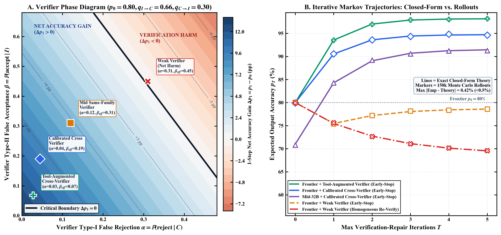
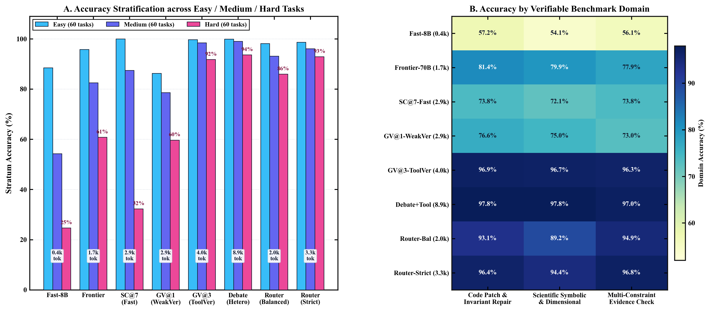
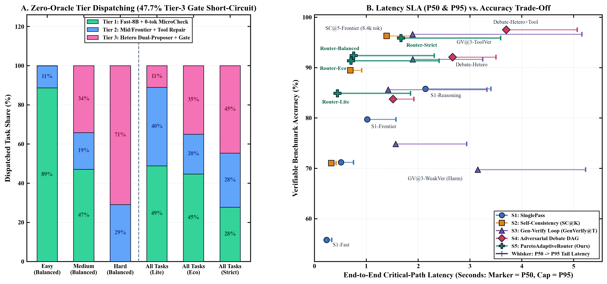

# CrossVerify-Bench: Markov-Chain Theory & Empirical Pareto Benchmark for Multi-Agent Cross-Verification and Heterogeneous Routing

[](https://www.python.org/)
[](LICENSE)
[](tests/test_crossverify.py)
[](crossverify/tasks.py)
[](crossverify/topologies.py)

> **Systems Motivation ([OmniHarness](https://github.com/WenNinghan/OmniHarness)):** Modern multi-agent workbenches such as `OmniHarness` coordinate heterogeneous language models and deterministic runtime tools, raising two foundational systems-and-optimization questions:
> 1. **When does adding a Verifier Agent genuinely improve accuracy versus actively corrupting a strong generator?**
> 2. **How should an orchestrator route tasks across single-pass models, iterative verifiers, and multi-agent debate DAGs to achieve Pareto-optimal `(Accuracy ↑, Token Cost ↓, P95 Latency ↓)`?**

`CrossVerify-Bench` provides both an **exact analytical Markov-chain theory** of iterative `Generator -> Verifier -> Conditional Repair` pipelines and a **180-task deterministic multi-domain benchmark** evaluating **28 multi-agent configurations** across 5 orchestration families ($`S_1`$–$`S_5`$).

---

## Executive Summary of Key Findings

1. **The Verification Harm Theorem (Why Weak Verifiers Degrade Strong Generators):**
   Pairing `Frontier-70B` (`79.70%` single-pass accuracy @ `1,679` tokens) with an uncalibrated `WeakVerifier` ($`\alpha = 0.31`$ false rejection, $`\beta = 0.45`$ false acceptance) **reduces accuracy by `-4.86 pp` at $`T=1`$ (`74.84%` @ `2,943` tokens)** and **`-9.96 pp` at $`T=3`$ homogeneous rounds (`69.74%` @ `5,566` tokens — `3.32x` token cost for strictly worse output)**.
2. **Exact Closed-Form Markov Alignment (`< 0.5%` Discrepancy):**
   Across both 60,000-trial synthetic rollouts and 100-seed 180-task benchmark evaluations, empirical `GenVerify@T` accuracies match our closed-form Markov equations with **maximum error `0.177%` (Monte Carlo) and `0.424%` (180-task benchmark)**.
3. **Correlated Error Ceiling of Self-Consistency (`SC@K`):**
   Scaling `Fast-8B` from `SinglePass` to `SC@9` multiplies token cost **`9.0x`** (`419 -> 3,769` tokens) while Hard-stratum accuracy saturates at **`31.1%`** due to systematic distractor concentration.
4. **Pareto Dominance of Zero-Oracle Adaptive Routing (`52%–70%` Token Reduction):**
   Our `ParetoAdaptiveRouter` ($`S_5`$)—combining zero-token prompt structural signals, deterministic AST/dimensional/constraint runtime micro-checks, and a heterogeneous **Smart Disagreement Gate**—expands **2D Cost–Accuracy Hypervolume by `+7.11%`** (`0.7598 -> 0.8139`) and **3D `(Accuracy, Cost, P95 Latency)` Hypervolume by `+7.22%`** (`0.6714 -> 0.7198`):
   - **`ParetoRouter-Eco` (Knee Point):** Reaches **`91.34%` accuracy @ `1,666` tokens**, saving **`52.2%` tokens** and **`26.0%` P95 latency** vs. `GenVerify@1 (Frontier + ToolVer)` (`91.65%` @ `3,484` tokens), and **`68.2%` tokens** vs. `SC@7 (Mid-32B)` (`91.56%` @ `5,240` tokens).
   - **`ParetoRouter-Balanced`:** Reaches **`92.39%` accuracy @ `1,960` tokens**, saving **`70.0%` tokens** vs. `DebateDAG (Hetero Mid+Frontier)` (`92.06%` @ `6,525` tokens) and **`51.2%` tokens / `55.2%` P95 latency** vs. `GenVerify@3 (Frontier + ToolVer)`.
   - **`ParetoRouter-Strict`:** Reaches **`95.85%` accuracy @ `3,310` tokens**, saving **`60.6%` tokens** vs. `SC@5 (Frontier-70B)` (`96.29%` @ `8,395` tokens).


---

## 1. Analytical Theory: Markov Cross-Verification Dynamics

We model iterative `Generator -> Verifier -> Conditional Repair` pipelines (`crossverify/markov_theory.py`) over latent correctness state $`X_t \in \{C\text{ (Correct)}, I\text{ (Incorrect)}\}`$ with initial generator accuracy $`p_0 = \mathbb{P}(X_0 = C)`$:

- **Verifier Error Profile:** Type-I false rejection $`\alpha = \mathbb{P}(\text{reject} \mid C)`$ and Type-II false acceptance $`\beta = \mathbb{P}(\text{accept} \mid I)`$.
- **Conditional Repair Transitions:** True-defect recovery probability $`q_{I\to C} = \mathbb{P}(X_t = C \mid X_{t-1} = I, \text{rejected})`$ and spurious-critique corruption probability $`q_{C\to I} = \mathbb{P}(X_t = I \mid X_{t-1} = C, \text{rejected})`$.

### Theorem 1 (Single-Step Net Gain & Critical Verification Harm Boundary)

After one round of verification and conditional repair ($`T = 1`$), both early-stopping and homogeneous pipelines yield exact accuracy:

```math
p_1 = p_0(1 - \alpha q_{C\to I}) + (1 - p_0)(1 - \beta) q_{I\to C}
```

with net accuracy gain:

```math
\Delta p_1 = p_1 - p_0 = (1 - p_0)(1 - \beta) q_{I\to C} - p_0 \alpha q_{C\to I}
```

Verification strictly improves generator accuracy ($`\Delta p_1 \gt 0`$) **if and only if**:

```math
\frac{\alpha}{1 - \beta} < \frac{1 - p_0}{p_0} \cdot \frac{q_{I\to C}}{q_{C\to I}}
```

> **Systems Implication:** As base generator accuracy $`p_0 \to 1`$, the odds factor $`\frac{1 - p_0}{p_0}`$ vanishes as $`O(1 - p_0)`$. Consequently, **the stronger the base generator, the stricter the upper bound on verifier false-rejection rate $`\alpha`$**. Attaching an uncalibrated critic ($`\alpha \gt \alpha^*(\beta)`$) pushes the system into the **Verification Harm Phase** ($`\Delta p_1 \lt 0`$).

### Theorem 2 (Multi-Round Closed-Form Trajectories & Early-Exit Absorption)

1. **Homogeneous Re-Verification Chain (`early_stop=False`):** With effective per-round corruption $`u = \alpha q_{C\to I}`$ and recovery $`v = (1 - \beta) q_{I\to C}`$, the $`T`$-step accuracy and stationary fixed point $`p^*`$ are:

```math
p_T = p^* + (p_0 - p^*)(1 - u - v)^T, \qquad p^* = \frac{(1 - \beta) q_{I\to C}}{(1 - \beta) q_{I\to C} + \alpha q_{C\to I}}
```

2. **Early-Stopping Conditional Repair (`early_stop=True`):** Halting immediately upon verifier acceptance induces an absorbing Markov chain with transient $`2\times 2`$ open-candidate operator:

```math
Q = \begin{pmatrix} \alpha(1 - q_{C\to I}) & (1 - \beta) q_{I\to C} \\ \alpha q_{C\to I} & (1 - \beta)(1 - q_{I\to C}) \end{pmatrix}, \qquad \mathbf{s}_t = Q^t \begin{pmatrix} p_0 \\ 1 - p_0 \end{pmatrix}
```

yielding exact $`T`$-step accuracy and expected token expenditure:

```math
p_T^{\text{early}} = (1 - \alpha)\sum_{t=0}^{T-1} [\mathbf{s}_t]_C + [\mathbf{s}_T]_C, \qquad \mathbb{E}[\text{Cost}_T^{\text{early}}] = c_{\text{gen}} + c_{\text{ver}} \sum_{t=0}^{T-1} \mathbf{1}^\top \mathbf{s}_t + c_{\text{rep}} \sum_{t=1}^{T} \mathbf{1}^\top \mathbf{s}_t
```

with exact asymptotic absorption accuracy:

```math
p_\infty^{\text{early}} = \frac{(1 - \alpha)\big(p_0 \beta + (1 - \beta) q_{I\to C}\big)}{(1 - \alpha)\big(\beta + (1 - \beta) q_{I\to C}\big) + \alpha \beta q_{C\to I}}
```



---

## 2. Verifiable 180-Task Benchmark & Zero-Oracle Micro-Checks

`crossverify/tasks.py` constructs **180 self-contained, deterministically verifiable tasks** evenly stratified across **3 domains (60 each)** and **3 difficulty tiers (60 Easy / 60 Medium / 60 Hard)**:

| Domain | Tasks | Problem Structure | Oracle Evaluator (`evaluate`) | Zero-Oracle Runtime Tool (`runtime_microcheck`) |
| :--- | :---: | :--- | :--- | :--- |
| **`code_patch`** | 60 | Clamped modular counting, gap-bridged interval coalescing, hop-constrained weighted DAG DP | Isolated AST compilation + multi-case boundary/adversarial unit assertions | Python `ast.parse`, signature arity, forbidden-import filter, public non-negativity/degenerate smoke check |
| **`scientific_symbolic`** | 60 | Bulk/surface reaction kinetics SI exponents `[L,M,T,mol]`, $`2\times 2`$ ODE Jacobian phase portraits, Schnakenberg Turing dispersion $`M(k)`$ | Exact dimensional vector match & `numpy.linalg.eigvals` spectral tolerance (`1e-3`) | JSON schema validation, molar conservation ($`M=0, T=-1`$), algebraic sign consistency ($`\det J`$, $`\max\operatorname{Re}\lambda`$) |
| **`evidence_crosscheck`** | 60 | Multi-source telemetry/ledger reconciliation under CRC integrity, authority tiers, MW-to-kW normalization & coupled DAG/mutex scheduling | Exact reconciled metric, invalidated-source set, and canonical lexicographic schedule | Permutation completeness, public precedence chain ($`W_0 \lt W_2 \lt W_4`$), and slot-mutex separation checks |

**Strict Zero-Oracle Guarantee:** Every task carries subtle semantic distractors (e.g., nested-interval `max` omission, $`k`$ vs. $`k^2`$ diffusion operator typo, stale or unnormalized MW/kW table selection) that **pass `runtime_microcheck` (`True`) while failing `evaluate` (`False`)**, ensuring runtime micro-checks act as genuine non-cheating pre-filters rather than ground-truth oracles. Similarly, `extract_prompt_features(prompt)` computes structural complexity solely from raw prompt text (`Easy: 0.207`, `Medium: 0.451`, `Hard: 0.716`), never reading `task.difficulty`.



---

## 3. Orchestration Topologies ($`S_1`$–$`S_5`$) & Empirical Benchmark (28 Configs)

`crossverify/topologies.py` implements five executable multi-agent topology families (compatible with both calibrated benchmark replay via `CalibratedReplayBackend` and live OpenAI/vLLM endpoints via `LiveOpenAIBackend`):

- **$`S_1`$ (`SinglePass`):** Direct single-model generation (`Fast-8B`, `Mid-32B`, `Frontier-70B`, `Reasoning-Pro`).
- **$`S_2`$ (`SelfConsistencyVote`, `SC@K`):** Parallel $`K \in \{3, 5, 7, 9\}`$ sampling with canonicalized confidence-weighted consensus.
- **$`S_3`$ (`GeneratorVerifierLoop`, `GenVerify@T`):** Iterative critique and conditional repair across `Weak`, `Mid`, `Calibrated Cross-Model`, and `Tool-Augmented` verifiers.
- **$`S_4`$ (`AdversarialDebateDAG`):** Explicit `networkx.DiGraph` 3-layer execution graph (`2 Proposers -> 2 Discrepancy Cross-Examiners -> Judge Synthesis`) with critical-path latency tracking.
- **$`S_5`$ (`ParetoAdaptiveRouter`):** Three-tier policy routing low-complexity prompts through `Fast-8B + 0-tok MicroCheck` (Tier 1), moderate/escalated tasks through `Mid/Frontier + Pre-Filtered Tool Repair` (Tier 2), and complex tasks through `Heterogeneous Dual-Proposers` with a **Smart Disagreement Gate** that short-circuits debate chatter (`47.7%` of Tier-3 arrivals) whenever independent heterogeneous proposals canonically agree and pass `runtime_microcheck` (Tier 3).



### Complete 28-Configuration Multi-Objective Results (180 Tasks × 100 Seeds)

| Config ID | Topology Configuration | Overall Acc (%) | Easy / Med / Hard (%) | Mean Tokens | P50 / P95 Latency (ms) | 2D Pareto | 3D Rank |
| :--- | :--- | :---: | :---: | :---: | :---: | :---: | :---: |
| `S1_Fast` | SinglePass (Fast-8B) | 55.80 | 88.5 / 54.2 / 24.7 | 419 | 235 / 336 | **Yes** | **1** |
| `S1_Mid` | SinglePass (Mid-32B) | 71.21 | 93.6 / 73.6 / 46.5 | 749 | 512 / 755 | **Yes** | **1** |
| `S1_Frontier` | SinglePass (Frontier-70B) | 79.70 | 95.8 / 82.5 / 60.8 | 1,679 | 1,017 / 1,574 | No | **1** |
| `S1_Reasoning` | SinglePass (Reasoning-Pro) | 85.77 | 97.7 / 88.0 / 71.6 | 3,300 | 2,141 / 3,406 | No | 2 |
| `S2_SC3_Fast` | SC@3 (Fast-8B) | 69.90 | 98.3 / 75.0 / 36.5 | 1,256 | 301 / 394 | No | **1** |
| `S2_SC5_Fast` | SC@5 (Fast-8B) | 71.02 | 99.7 / 81.9 / 31.4 | 2,093 | 326 / 417 | No | **1** |
| `S2_SC7_Fast` | SC@7 (Fast-8B) | 73.22 | 100.0 / 87.4 / 32.3 | 2,932 | 343 / 430 | No | **1** |
| `S2_SC9_Fast` | SC@9 (Fast-8B) | 74.07 | 100.0 / 91.2 / 31.1 | 3,769 | 358 / 446 | No | **1** |
| `S2_SC3_Mid` | SC@3 (Mid-32B) | 85.43 | 99.6 / 91.1 / 65.6 | 2,245 | 642 / 866 | No | **1** |
| `S2_SC5_Mid` | SC@5 (Mid-32B) | 89.45 | 100.0 / 96.8 / 71.6 | 3,744 | 694 / 913 | No | **1** |
| `S2_SC7_Mid` | SC@7 (Mid-32B) | 91.56 | 100.0 / 98.8 / 76.0 | 5,240 | 729 / 946 | No | **1** |
| `S2_SC5_Frontier` | SC@5 (Frontier-70B) | 96.29 | 100.0 / 99.2 / 89.7 | 8,395 | 1,391 / 1,883 | No | **1** |
| `S3_GV1_Frontier_WeakVer` | GenVerify@1 (Frontier + WeakVer) **[Harm]** | 74.84 | 86.3 / 78.6 / 59.7 | 2,943 | 1,565 / 2,937 | No | 3 |
| `S3_GV3_Frontier_WeakVer_Homog` | GenVerify@3-Homog (Frontier + WeakVer) **[Harm]** | 69.74 | 79.1 / 71.5 / 58.7 | 5,566 | 3,151 / 5,233 | No | 4 |
| `S3_GV1_Fast_MidVer` | GenVerify@1 (Fast + MidVer) | 62.47 | 90.2 / 64.6 / 32.7 | 1,529 | 803 / 1,156 | No | 2 |
| `S3_GV2_Mid_MidVer` | GenVerify@2 (Mid + MidVer) | 79.98 | 96.6 / 82.9 / 60.5 | 2,249 | 1,086 / 2,647 | No | 2 |
| `S3_GV1_Mid_CalibVer` | GenVerify@1 (Mid + CalibVer) | 81.16 | 97.5 / 84.7 / 61.3 | 2,447 | 1,424 / 2,142 | No | 2 |
| `S3_GV2_Mid_CalibVer` | GenVerify@2 (Mid + CalibVer) | 85.61 | 98.1 / 89.6 / 69.1 | 2,911 | 1,423 / 3,328 | No | 2 |
| `S3_GV2_Frontier_CalibVer` | GenVerify@2 (Frontier + CalibVer) | 91.17 | 99.1 / 93.9 / 80.5 | 3,899 | 1,939 / 4,566 | No | 3 |
| `S3_GV1_Frontier_ToolVer` | GenVerify@1 (Frontier + ToolVer) | 91.65 | 99.2 / 94.8 / 81.0 | 3,484 | 1,896 / 3,248 | No | 2 |
| `S3_GV3_Frontier_ToolVer` | GenVerify@3 (Frontier + ToolVer) | 96.63 | 99.7 / 98.5 / 91.8 | 4,016 | 1,894 / 5,160 | **Yes** | **1** |
| `S4_Debate_Homog_Mid` | DebateDAG (Homog 2xMid) | 83.75 | 97.7 / 88.1 / 65.5 | 3,918 | 1,516 / 1,919 | No | 2 |
| `S4_Debate_Hetero_MidFrontier` | DebateDAG (Hetero Mid+Frontier) | 92.06 | 99.3 / 95.4 / 81.5 | 6,525 | 2,664 / 3,503 | No | 2 |
| `S4_Debate_Hetero_ToolJudge` | DebateDAG (Frontier+Reasoning + ToolJudge) | **97.51** | 99.9 / 99.0 / 93.7 | 8,875 | 3,699 / 5,069 | **Yes** | **1** |
| **`S5_Router_Lite`** | **ParetoRouter-Lite** | **84.88** | 97.0 / 86.8 / 70.9 | **1,139** | 445 / 1,855 | **Yes** | **1** |
| **`S5_Router_Eco`** | **ParetoRouter-Eco (Knee Point)** | **91.34** | 98.4 / 93.1 / 82.6 | **1,666** | 705 / 2,405 | **Yes** | **1** |
| **`S5_Router_Balanced`** | **ParetoRouter-Balanced** | **92.39** | 98.1 / 93.1 / 85.9 | **1,960** | 758 / 2,312 | **Yes** | **1** |
| **`S5_Router_Strict`** | **ParetoRouter-Strict** | **95.85** | 98.6 / 96.1 / 92.9 | **3,310** | 1,671 / 3,593 | **Yes** | **1** |

---

## 4. Concrete Scheduling & Verification Heuristics for `OmniHarness`

The theoretical and empirical findings of `CrossVerify-Bench` translate directly into four production scheduling rules for multi-agent workbenches such as **`OmniHarness`**:

1. **Enforce the Markov Precision Gate ($`\alpha \lt \alpha^*`$) Before Spawning Critics:**
   Never attach a lightweight or uncalibrated LLM critic to a stronger generator. When $`p_0 \ge 0.80`$, require either a cross-family frontier verifier ($`\alpha \le 0.05`$) or deterministic runtime tool grounding; otherwise bypass LLM verification to prevent negative Markov drift.
2. **Pre-Filter with Zero-Token Deterministic Micro-Checks Before LLM Verification:**
   Run AST compilation, schema validation, dimensional conservation, or public constraint checks *before* invoking an LLM verifier. When a runtime check fails, route `stderr` diagnostics directly to conditional repair—saving `~1,300` verifier tokens per syntax/invariant error and slashing effective Type-II false acceptance $`\beta_{\text{eff}}`$ by `>65%`.
3. **Replace Homogeneous `SC@K` on Hard Tasks with Heterogeneous Disagreement Gating:**
   On high-complexity prompts ($`s_{\text{struct}} \ge 0.58`$), run two *architecturally distinct* proposers in parallel and short-circuit immediately if their canonicalized outputs agree and pass `runtime_microcheck` (`47.7%` short-circuit rate), invoking judge synthesis *only* upon genuine discrepancy.
4. **Select Operating Modes Along the Marginal Token Utility Curve:**
   - Tight Latency SLA (`P95 < 1.0s`): Parallel `SC@5 (Mid-32B)` (`89.5%` @ `913 ms` P95).
   - Balanced Cost–Accuracy Knee (`< 2.0k` tokens/task): `ParetoRouter-Eco` / `ParetoRouter-Balanced` (`91.3%–92.4%` @ `1,666–1,960` tokens).
   - Maximum Verification Assurance: `GenVerify@3 (Frontier + ToolVer)` (`96.6%` @ `4,016` tokens) or `DebateDAG (Hetero + ToolJudge)` (`97.5%` @ `8,875` tokens).

---

## 5. Quickstart & Reproducibility

### Installation

```bash
pip install -e ".[dev]"
```

### Run Unit Tests, Full Benchmark, and Figure Generation

```bash
# 1. Run analytical Markov, Pareto Hypervolume, task evaluator, and router tests
pytest

# 2. Execute the 28-config x 180-task x 100-seed benchmark -> results/
python scripts/run_benchmark.py

# 3. Generate all four 300-DPI publication figures -> assets/
python scripts/generate_figures.py
```

### Pluggable Live OpenAI / vLLM API Usage

```python
import numpy as np
from crossverify import LiveOpenAIBackend, ParetoAdaptiveRouter, build_benchmark_suite

suite = build_benchmark_suite()
backend = LiveOpenAIBackend(api_key="YOUR_API_KEY", base_url="https://api.openai.com/v1")
router = ParetoAdaptiveRouter("live_router", "OmniHarness-Router")

trace = router.run_task(suite[0], backend, rng=np.random.default_rng(0))
print(f"Tier={trace.router_tier} | Correct={trace.is_correct} | Tokens={trace.total_tokens:.0f}")
```

---

## Repository Structure

```text
CrossVerify-Bench/
├── crossverify/
│   ├── __init__.py          # Public package exports
│   ├── markov_theory.py     # Closed-form Markov chain, harm thresholds & MC rollouts
│   ├── tasks.py             # 180 deterministic tasks + zero-oracle micro-checks
│   ├── topologies.py        # S1-S5 multi-agent orchestrators + LiveOpenAIBackend
│   └── pareto.py            # NSGA-II 3D sorting, exact 2D/3D Hypervolume & knee finder
├── scripts/
│   ├── run_benchmark.py     # Multi-seed 28-configuration evaluation & theory validation
│   └── generate_figures.py  # 300-DPI publication figure generator
├── tests/
│   └── test_crossverify.py  # Pytest suite verifying theory, hypervolumes & tasks
├── results/
│   ├── crossverify_pareto_benchmark.json
│   └── topology_comparison.csv
├── assets/
│   ├── pareto_frontier_cost_vs_accuracy.png
│   ├── verifier_phase_diagram.png
│   ├── difficulty_stratified_breakdown.png
│   └── routing_allocation_and_latency.png
├── pyproject.toml
├── requirements.txt
└── LICENSE
```

## License

Released under the [MIT License](LICENSE). Copyright (c) 2026 WenNinghan.
