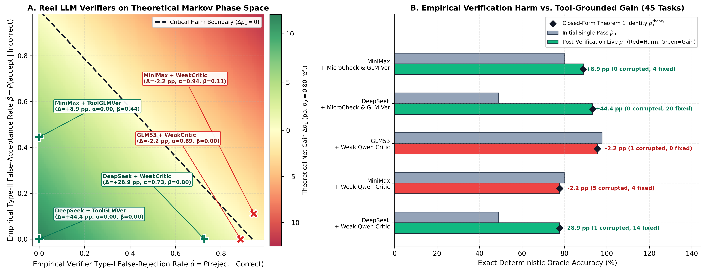

# CrossVerify-Bench: Cost–Error Accounting & Multi-Family LLM Benchmark for Harness Guardrails, Differential Testing, and NVP Routing

[](https://www.python.org/)
[](LICENSE)
[](tests/test_crossverify.py)
[](results/live_llm_traces.jsonl)
[](scripts/run_live_llm_benchmark.py)

> **Engineering Context ([OmniHarness](https://github.com/WenNinghan/OmniHarness) & *The Bitter Lesson*):** As base reasoning models internalize chain-of-thought self-correction, purely verbal multi-agent orchestration (free-form LLM critics, static multi-agent debate) increasingly turns into token overhead rather than net capability gain. What remains durable inside an **Agent Harness** are two things model weights cannot internalize on their own:
> 1. **External Deterministic Partial Oracles:** Classical software testing primitives—**Smoke Guardrails**, **Property-Based Testing (PBT)** invariants, and **Differential Testing (DT)**—that provide zero-hallucination falsification signals;
> 2. **Cost–Latency Cascade Routing:** Using classical **N-Version Programming (NVP)** + **Differential Testing** across cheap fast models to safely early-exit easy/moderate requests without paying frontier model token and latency costs on every call.

`CrossVerify-Bench` is an empirical measurement study and reproducible harness benchmark comprising:
1. **`CrossVerify-Live-45` (`1,000` verbatim real API traces in [`results/live_llm_traces.jsonl`](results/live_llm_traces.jsonl)):** Evaluating `Qwen`, `DeepSeek`, `GLM`, `MiMo`, and `MiniMax` across single-pass baselines, LLM-critic repair loops, 3-family debate DAGs, and **Guardrail + Differential Testing + NVP** early-exit cascades;
2. **Transparent Cost–Error Accounting (`crossverify/markov_theory.py`):** Elementary total-probability accounting for single-round review ($`T=1`$) and absorbing stopping-time recurrences for multi-round early-exit token budgets ($`T>1`$);
3. **180-Task × 100-Seed Parametric Simulation (`CalibratedReplayBackend`):** Stress-testing multi-round stopping rules and correlated failure ceilings (Knight & Leveson, 1986) at larger sample counts.

---

## Key Empirical Takeaways (and Honest Statistical Boundaries)

1. **Uncalibrated LLM Critics Trigger Extreme False-Rejection Waste (`88.6%–94.4%` False Rejects):**
   Attaching the same fast non-thinking critic (`qwen3.8-flash`) across three generator tiers illustrates basic conditional-probability accounting $`\Delta p_1 = (1-p_0)(1-\beta)q_{I\to C} - p_0\alpha q_{C\to I}`$:
   - **Weak Generator (`deepseek-flash`, `48.89%`):** Critic loop lifts accuracy to **`77.78%` (`+28.89 pp`)** (`14` wrong answers fixed vs. `1` correct answer broken).
   - **Mid-Strong Generator (`minimax-m3.1-flash`, `80.00%`):** Critic **falsely rejects `34/36` (`94.4%`)** already-correct outputs, causing **`9` underlying task flips (`5` originally-correct solutions corrupted vs. `4` errors fixed, netting `36 -> 35`, i.e. `80.00% -> 77.78%`)** while burning **`4.62x` tokens** (`723 -> 3,340` tok) and **`2.8x` P50 latency**.
   - **Strong Generator (`glm-5.3-flashx`, `97.78%`):** Critic **falsely rejects `39/44` (`88.6%`)** correct outputs (`1` corrupted, `0` fixed, `44 -> 43`, i.e. `97.78% -> 95.56%`) while burning **`3.32x` tokens** (`2,159 -> 7,163` tok).
   - *Statistical Power Note:* On $`N=45`$ tasks (`2.22%` per task), a net endpoint delta of `-1` task alone lies within paired McNemar binomial noise ($`p \gt 0.50`$) and does **not** by itself prove net accuracy degradation; the statistically decisive failure ($`p \lt 10^{-7}`$) is the **`88.6%–94.4%` Type-I false-rejection rate**, the **`5` gaslit corruptions** hidden behind `-5/+4` cancellation, and the **`3.3x–4.6x` pure Pareto token/latency waste**.
2. **Deterministic Guardrails + Strong Cross-Family Review Eliminate False Rejections ($`\hat{\alpha} = 0.000`$):**
   Running a `0-token` deterministic smoke/invariant guardrail (`runtime_microcheck`) before a stronger cross-family reviewer (`glm-5.3-flashx`) yields **`0` false rejections and `0` corruptions**, lifting `deepseek-flash` **`48.89% -> 93.33%`** (`0` broken / `20` fixed) and `minimax-m3.1-flash` **`80.00% -> 88.89%`** (`0` broken / `4` fixed).
3. **Pure Verbal Multi-Agent Debate Underperforms Single-Pass Frontier Models on Cost–Accuracy:**
   Running a static 3-family `DebateDAG` (`GLM-5.3` × `MiMo-V2.6` -> `MiniMax-M3` judge) spends **`5,128` tokens/task** for **`95.56%`** (`43/45`)—costing **`2.38x` more tokens** than single-pass `GLM-5.3-FlashX` (`97.78%` @ `2,159` tok) because free-form judge synthesis occasionally overwrites valid proposer solutions.
4. **Classical Software Testing (`Guardrails + Differential Testing + NVP`) as a Cheap Cascade Early-Exit:**
   Although fast `qwen3.8-flash` (`64.4%`) and `deepseek-flash` (`48.9%`) are individually weak, when two independent model families (**N-Version Programming**) both pass deterministic invariant guardrails (**PBT / Smoke Check**) and agree on `8` random test inputs (**Differential Testing**), their empirical precision on the agreed subset is **`19/19 = 100.0%`** at **`~770` tokens**—allowing `ParetoRouter-Eco` (`95.56%` @ `1,866` tok) and `ParetoRouter-Strict` (`100.00%` @ `3,050` tok) to cut token spend by **`40.5%–63.6%`** vs. static 3-family debate.


---

## Classical Software Engineering Lineage (No Buzzwords Needed)

The verification primitives evaluated in `CrossVerify-Bench` directly instantiate well-established techniques from dependable computing and software testing inside an LLM Harness:

| Harness Mechanism in Repo | Classical SE / Fault-Tolerance Concept | Role & Known Limitation in LLM Cascades |
| :--- | :--- | :--- |
| `runtime_microcheck` (`0-token` AST, schema, dimensional & conservation checks) | **Smoke Testing / Partial Test Oracles / PBT Invariants** (Claessen & Hughes, 2000) | Necessary but non-sufficient partial oracle: catches syntax/schema/unit violations at zero token cost before any LLM critic runs. |
| Synthesizing `8` random inputs and comparing `Qwen` vs. `DeepSeek` outputs | **Differential Testing (DT)** (McKeeman, 1998) | Detects behavioral divergence on executable code without ground-truth labels; limited when tasks lack executable input spaces. |
| Dual/Triple multi-family generation (`Qwen` × `DeepSeek` × `GLM`/`MiMo`) | **N-Version Programming (NVP)** (Avizienis, 1977) | Mitigates single-model quirks, but remains subject to **correlated common-mode failures** on hard edge cases (Knight & Leveson, 1986)—explaining why homogeneous `SC@K` plateaus on Hard tasks (`~31%`). |

---

## Part I: Real Multi-Family Live LLM Benchmark (`CrossVerify-Live-45`)

`crossverify/live_suite.py` defines **45 zero-hint, deterministically verifiable tasks** (`15 Easy / 15 Medium / 15 Hard` across executable Python `code_patch`, aqueous ozonation & PDE `scientific_symbolic`, and multi-sensor parity/anti-spoofing `evidence_crosscheck`). Every configuration was evaluated over live `/v1/messages` endpoints across **5 distinct model families**, logging verbatim responses and token usage in [`results/live_llm_traces.jsonl`](results/live_llm_traces.jsonl).

### 1. Process-Level Audit of Generator–Critic Loops ($`T = 1`$)



| Live `S3` Pipeline (`Generator + Verifier`) | Base $`\hat{p}_0`$ (%) | Post-Verify $`\hat{p}_1`$ (%) | Accounting $`p_1`$ (%) | Net $`\Delta p_1`$ (pp) | False Reject Rate $`\hat{\alpha}`$ | False Accept Rate $`\hat{\beta}`$ | Underlying Flips (`Corrupted / Fixed`) | Mean Tokens (`Multiplier`) |
| :--- | :---: | :---: | :---: | :---: | :---: | :---: | :---: | :---: |
| `DeepSeek-Flash` + `Weak Qwen Critic` | 48.89 (`22/45`) | **77.78** (`35/45`) | 77.78 | **`+28.89`** | `16/22` (`72.7%`) | `0/23` (`0.0%`) | `1` broken / **`14` fixed** | 2,270 (`5.95x`) |
| `MiniMax-M3.1` + `Weak Qwen Critic` | 80.00 (`36/45`) | **77.78** (`35/45`) | 77.78 | `-2.22` | **`34/36` (`94.4%`)** | `1/9` (`11.1%`) | **`5` broken** / `4` fixed | 3,340 (**`4.62x`**) |
| `GLM-5.3-FlashX` + `Weak Qwen Critic` | 97.78 (`44/45`) | **95.56** (`43/45`) | 95.56 | `-2.22` | **`39/44` (`88.6%`)** | `0/1` (`0.0%`) | **`1` broken** / `0` fixed | 7,163 (**`3.32x`**) |
| `DeepSeek-Flash` + `Guardrail & GLM-5.3 Ver` | 48.89 (`22/45`) | **93.33** (`42/45`) | 93.33 | **`+44.44`** | **`0/22` (`0.0%`)** | `0/23` (`0.0%`) | **`0` broken / `20` fixed** | 2,239 (`5.86x`) |
| `MiniMax-M3.1` + `Guardrail & GLM-5.3 Ver` | 80.00 (`36/45`) | **88.89** (`40/45`) | 88.89 | **`+8.89`** | **`0/36` (`0.0%`)** | `4/9` (`44.4%`) | **`0` broken / `4` fixed** | 2,669 (`3.69x`) |

### 2. Verbatim Real-API Case Studies: How Spurious Critiques Corrupt Valid Solutions

Both examples below are taken verbatim from [`results/live_llm_benchmark.json`](results/live_llm_benchmark.json) and [`results/live_llm_traces.jsonl`](results/live_llm_traces.jsonl):

- **Case A (`live_sci_easy_03` — 4th-Order Bulk Kinetics Dimensional Analysis on `GLM-5.3-FlashX`):**
  - **Initial `GLM-5.3-FlashX` Output (Correct):** `{"order": 4, "units": [9, 0, -1, -3]}` (since $`[\text{X}] = \text{mol}\cdot L^{-3}`$, rate $`r = k[\text{A}]^2[\text{B}]^2`$ gives $`[k] = L^9\,\text{mol}^{-3}\,\text{s}^{-1}`$).
  - **Uncalibrated `Qwen3.8-Flash` Critique (Spurious Rejection):** *"REJECT: The dimensional exponent vector is incorrect. For a 4th order reaction in 3D, the units of k are L^3 mol^-1 s^-1 (or M^-3 T^-1). The correct vector [L, M, T, mol] should be [3, -1, -1, 0]."* (Conflating liters with length $`L`$ and molarity $`\text{M}`$ with mass $`M`$!)
  - **Post-Repair `GLM-5.3-FlashX` Output (Corrupted):** `{"order": 4, "units": [3, 0, -1, -1]}`.

- **Case B (`live_sci_hard_04` — Schnakenberg PDE Turing Dispersion on `MiniMax-M3.1`):**
  - **Initial `MiniMax-M3.1` Output (Correct):** `{"dispersion_abscissa": -0.1029, "frob_norm_sq": 135.5320, "regime": "dispersion_stable", "u_star": 1.1500}`.
  - **Uncalibrated `Qwen3.8-Flash` Critique (Hallucinated Eigenvalue):** *`{"verdict": "REJECT", "critique": "The dispersion_abscissa is incorrect. The correct value is approximately 0.1462 (positive), indicating a Turing unstable regime, not stable."}`*
  - **Post-Repair `MiniMax-M3.1` Output (Corrupted):** `{"dispersion_abscissa": 0.1462, "frob_norm_sq": 135.5320, "regime": "turing_unstable", "u_star": 1.1500}`.

### 3. Complete 15-Configuration Live Multi-Family Results (45 Tasks)

| Config ID | Live Configuration | Overall Acc (%) | Easy / Med / Hard (%) | Mean Tokens | P50 / P95 Latency (ms) | 2D Pareto | 3D Rank |
| :--- | :--- | :---: | :---: | :---: | :---: | :---: | :---: |
| `S1_DeepSeekFlash_NoThink` | SinglePass: `deepseek-flash` (NoThink) | 48.89 | 40.0 / 73.3 / 33.3 | **382** | 2,574 / 6,160 | **Yes** | **1** |
| `S1_QwenFlash_NoThink` | SinglePass: `qwen3.8-flash` (NoThink) | 64.44 | 80.0 / 93.3 / 20.0 | **389** | 1,799 / 6,755 | **Yes** | **1** |
| `S1_MiniMax_M31` | SinglePass: `minimax-m3.1-flash` | 80.00 | 66.7 / 100.0 / 73.3 | **723** | 9,615 / 17,716 | **Yes** | **1** |
| `S1_MiMo_V26` | SinglePass: `mimo-v2.6-flash` | 93.33 | 86.7 / 100.0 / 93.3 | 1,737 | 4,120 / 17,227 | **Yes** | **1** |
| `S1_GLM53_FlashX` | SinglePass: `glm-5.3-flashx` | 97.78 | 93.3 / 100.0 / 100.0 | 2,159 | 4,667 / 24,999 | **Yes** | **1** |
| `S2_SC3_QwenFlash` | SC@3: `qwen3.8-flash` (NoThink) | 62.22 | 80.0 / 86.7 / 20.0 | 1,165 | 2,217 / 15,579 | No | 2 |
| `S2_SC5_DeepSeekFlash` | SC@5: `deepseek-flash` (NoThink) | 57.78 | 46.7 / 93.3 / 33.3 | 1,636 | 2,942 / 6,758 | No | 2 |
| `S3_DeepSeek_WeakQwenCritic` | GenVerify: `deepseek-flash` + Weak Qwen Critic | 77.78 | 86.7 / 93.3 / 53.3 | 2,270 | 11,876 / 20,784 | No | 3 |
| `S3_MiniMax_WeakQwenCritic` | GenVerify: `minimax-m3.1` + Weak Qwen Critic | 77.78 | 53.3 / 100.0 / 80.0 | 3,340 | 26,831 / 50,501 | No | 4 |
| `S3_GLM53_WeakQwenCritic` | GenVerify: `glm-5.3-flashx` + Weak Qwen Critic | 95.56 | 86.7 / 100.0 / 100.0 | 7,163 | 23,979 / 80,265 | No | 3 |
| `S3_DeepSeek_ToolGLMVer` | GenVerify: `deepseek-flash` + Guardrail + `glm-5.3` Ver | 93.33 | 93.3 / 100.0 / 86.7 | 2,239 | 8,541 / 20,636 | No | 2 |
| `S3_MiniMax_ToolGLMVer` | GenVerify: `minimax-m3.1` + Guardrail + `glm-5.3` Ver | 88.89 | 66.7 / 100.0 / 100.0 | 2,669 | 16,009 / 44,519 | No | 3 |
| `S4_HeteroDebate_3Family` | DebateDAG: `glm-5.3` × `mimo-v2.6` -> `minimax-m3` Judge | 95.56 | 86.7 / 100.0 / 100.0 | 5,128 | 13,400 / 41,384 | No | 2 |
| **`S5_ParetoRouter_Eco`** | **Cascade-Eco (`Qwen×DS` DT/NVP Gate + `MiMo` + Guardrail)** | **95.56** | 93.3 / 100.0 / 93.3 | **1,866** | 5,375 / 25,784 | **Yes** | **1** |
| **`S5_ParetoRouter_Strict`** | **Cascade-Strict (DT/NVP Early-Exit + 2-of-3 Hetero Quorum)** | **100.00** | **100.0 / 100.0 / 100.0** | **3,050** | 5,830 / 44,624 | **Yes** | **1** |

---

## Cost–Error Probability Accounting & Multi-Round Stopping (`crossverify/markov_theory.py`)

### 1. Single-Round Review Accounting ($`T = 1`$)
For a single round of review and conditional repair from base accuracy $`p_0`$, let $`\alpha = \mathbb{P}(\text{reject} \mid C)`$ be the critic's Type-I false-rejection rate, $`\beta = \mathbb{P}(\text{accept} \mid I)`$ its Type-II false-acceptance rate, $`q_{I\to C}`$ the repair recovery rate on rejected errors, and $`q_{C\to I}`$ the corruption rate when a valid answer is falsely rejected. By elementary total probability:

```math
p_1 = p_0(1 - \alpha q_{C\to I}) + (1 - p_0)(1 - \beta) q_{I\to C}, \qquad \Delta p_1 = (1 - p_0)(1 - \beta) q_{I\to C} - p_0 \alpha q_{C\to I}
```

Thus a review step yields positive expected accuracy gain ($`\Delta p_1 \gt 0`$) if and only if:

```math
\frac{\alpha}{1 - \beta} < \frac{1 - p_0}{p_0} \cdot \frac{q_{I\to C}}{q_{C\to I}}
```

As base generator accuracy $`p_0 \to 1`$, the prior error odds $`(1 - p_0)/p_0`$ shrink toward zero, requiring near-zero false rejections ($`\alpha \approx 0`$, e.g., deterministic compiler/guardrail checks) to avoid wasting tokens and corrupting valid solutions.

### 2. Multi-Round Stopping Rules & Expected Token Recurrence ($`T > 1`$)
When iterating beyond a single round ($`T > 1`$), state transition recurrences distinguish two stopping rules:
1. **Unconditional Re-Review (`early_stop=False`):** Re-evaluating every round with effective corruption $`u = \alpha q_{C\to I}`$ and recovery $`v = (1 - \beta) q_{I\to C}`$ forgets $`p_0`$ and drifts geometrically toward $`p^{*} = v / (u + v)`$:

```math
p_T = p^{*} + (p_0 - p^{*})(1 - u - v)^T
```

2. **Early-Stop on Acceptance (`early_stop=True`):** Exiting immediately once the verifier accepts induces a $`2\times 2`$ open-candidate recurrence $`\mathbf{s}_t = Q^t [p_0, \; 1 - p_0]^\top`$, determining expected multi-round token expenditure:

```math
Q = \begin{pmatrix} \alpha(1 - q_{C\to I}) & (1 - \beta) q_{I\to C} \\ \alpha q_{C\to I} & (1 - \beta)(1 - q_{I\to C}) \end{pmatrix}, \qquad \mathbb{E}[\text{Cost}_T^{\text{early}}] = c_{\text{gen}} + (c_{\text{ver}} + c_{\text{rep}}) \sum_{t=0}^{T-1} \mathbf{1}^\top \mathbf{s}_t - c_{\text{rep}}(1 - \alpha_{\text{eff}, T})
```


---

## Part II: Controlled Parametric Multi-Round Simulation (180 Tasks × 28 Configs × 100 Seeds)

To inspect multi-round $`T \in \{1, 2, 3\}`$ stopping recurrences and large-sample variance bounds beyond single-round live API budgets, `crossverify/tasks.py` and `CalibratedReplayBackend` (`crossverify/topologies.py`) evaluate a **180-task deterministic suite** (`60 Easy / 60 Medium / 60 Hard` across `code_patch`, `scientific_symbolic`, and `evidence_crosscheck`, with zero-oracle `runtime_microcheck` partial assertions such as AST parse, molar conservation $`M=0, T=-1`$, and Jacobian/dispersion sign consistency $`\det J`$, $`\max\,\mathrm{Re}(\lambda)`$) across **28 configurations × 100 Monte-Carlo seeds**:

- **Multi-Round Drift Verification:** Empirical `GenVerify@T` trajectories match the closed-form multi-round recurrence within **`0.177%`** (60,000-trial rollouts) and **`0.424%`** (180-task suite), illustrating cumulative degradation (`79.70% -> 74.84%` at $`T=1`$ -> `69.74%` at $`T=3`$) when an uncalibrated critic is iterated without early-exit guardrails.
- **Cost–Latency–Accuracy Trade-off:** Across 28 configurations, combining deterministic partial-oracle guardrails with disagreement-gated escalation expands **2D Cost–Accuracy Hypervolume by `+7.11%`** and **3D `(Accuracy, Cost, P95 Latency)` Hypervolume by `+7.22%`**, cutting token usage by **`52%–70%`** relative to static debate DAGs.


---

## Quickstart & Zero-Key Reproducibility

### Installation

```bash
pip install -e ".[dev]"
```

### 1. Replay & Audit the 1,000 Real Live-LLM Traces (Zero API Key Needed)

Every live LLM call from our 5-family evaluation is stored verbatim in [`results/live_llm_traces.jsonl`](results/live_llm_traces.jsonl) (zero credentials stored). Anyone can audit all paired flips, false-rejection counts, and figures offline in `< 2s`:

```bash
# Run all 13 unit & trace-integrity tests
pytest -v

# Replay all 15 configurations across 1,000 real LLM traces offline -> results/live_llm_benchmark.json
python scripts/run_live_llm_benchmark.py

# Regenerate 300-DPI live empirical figures -> assets/live_llm_*.png
python scripts/generate_live_figures.py
```

### 2. Run Against Your Own Live `/v1/messages` or OpenAI/vLLM Endpoint

```bash
export CROSSVERIFY_API_KEY="your-api-key"
export CROSSVERIFY_BASE_URL="https://api.anthropic.com"
python scripts/run_live_llm_benchmark.py
```

### 3. Run the 28-Config × 180-Task Multi-Round Simulation

```bash
python scripts/run_benchmark.py
python scripts/generate_figures.py
```

---

## References (Classical Fault-Tolerance & Testing Lineage)

1. Avizienis, A., & Chen, L. (1977). On the implementation of N-version programming for software fault-tolerance during execution. *COMPSAC*, 149–155.
2. Knight, J. C., & Leveson, N. G. (1986). An experimental evaluation of the assumption of independence in multiversion programming. *IEEE Transactions on Software Engineering*, SE-12(1), 96–109.
3. McKeeman, W. M. (1998). Differential testing for software. *Digital Technical Journal*, 10(1), 100–107.
4. Claessen, K., & Hughes, J. (2000). QuickCheck: A lightweight tool for random testing of Haskell programs. *ACM SIGPLAN Notices (ICFP)*, 35(9), 268–279.

## License

Released under the [MIT License](LICENSE). Copyright (c) 2026 WenNinghan.
