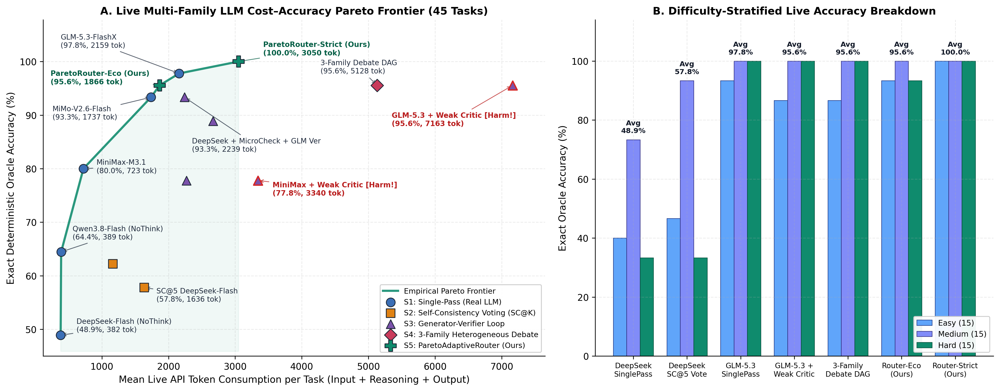
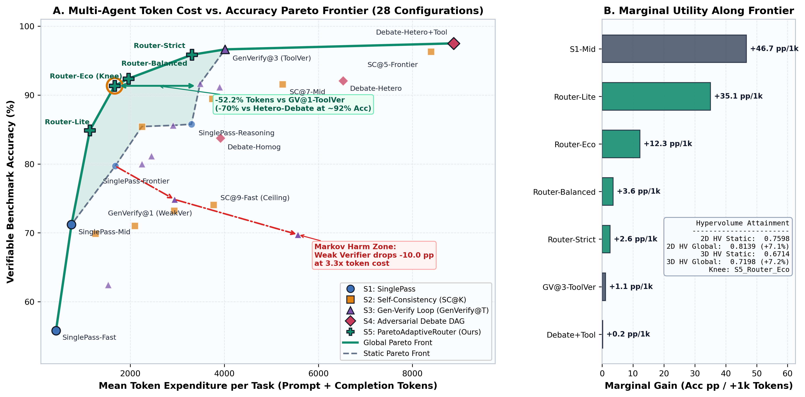

# CrossVerify-Bench: Markov-Chain Theory & Real Multi-Family LLM Pareto Benchmark for Cross-Verification and Heterogeneous Routing

[](https://www.python.org/)
[](LICENSE)
[](tests/test_crossverify.py)
[](results/live_llm_traces.jsonl)
[](scripts/run_live_llm_benchmark.py)

> **Systems Motivation ([OmniHarness](https://github.com/WenNinghan/OmniHarness)):** Modern multi-agent workbenches coordinate heterogeneous LLMs alongside deterministic local tools, raising two foundational systems-and-optimization questions:
> 1. **The Reviewer Paradox (Verification Harm):** Why does attaching the *exact same* LLM Reviewer boost a weak generator by `+28.9 pp`, yet actively **degrade** strong generators (`MiniMax-M3.1`, `GLM-5.3-FlashX`) while burning `3.3x–4.6x` more tokens?
> 2. **Zero-Oracle Pareto Routing:** How can an orchestrator route tasks across fast non-thinking probes, deterministic runtime micro-checks, **Differential Property Fuzzing**, and multi-family arbiters to achieve Pareto-optimal `(Accuracy ↑, Real API Tokens ↓, Latency ↓)` without ground-truth leakage?

`CrossVerify-Bench` combines **(1) an exact analytical Markov-chain theory** of iterative `Generator -> Verifier -> Conditional Repair` pipelines, **(2) a 100% real-API multi-family LLM benchmark (`CrossVerify-Live-45`, `1,000` verbatim `/v1/messages` traces across `Qwen`, `DeepSeek`, `GLM`, `MiMo`, and `MiniMax` committed in [`results/live_llm_traces.jsonl`](results/live_llm_traces.jsonl))**, and **(3) a 180-task × 100-seed controlled parametric stress test (`CalibratedReplayBackend`)** verifying asymptotic $`T \to \infty`$ convergence.

---

## Executive Summary of Live Multi-Family Findings

1. **Live Proof of the Markov Verification Harm Phase Transition (`Theorem 1`):**
   Evaluating the **exact same uncalibrated fast critic** (`qwen3.8-flash`, non-thinking) across three generator tiers reveals an empirical phase flip from large gain to active corruption:
   - **Weak Generator (`deepseek-flash`):** Accuracy jumps **`48.89% -> 77.78%` (`+28.89 pp`)** (`14` errors fixed vs. `1` corrupted).
   - **Mid-Strong Generator (`minimax-m3.1-flash`):** The critic falsely rejects **`34/36` (`94.4%`)** already-correct answers, gaslighting the generator into corrupting `5` correct solutions and **dropping accuracy `80.00% -> 77.78%` (`-2.22 pp`)** at **`4.62x` token cost** (`723 -> 3,340` tok).
   - **Frontier Reasoning Generator (`glm-5.3-flashx`):** The critic falsely rejects **`39/44` (`88.6%`)** correct answers and **drops accuracy `97.78% -> 95.56%` (`-2.22 pp`)** at **`3.32x` token cost** (`2,159 -> 7,163` tok).
2. **Eliminating Type-I False Rejections via Tool-Grounded Cross-Verification ($`\hat{\alpha} = 0.000`$):**
   Pre-filtering syntax/dimensional/schema invariants with a `0-token` deterministic `runtime_microcheck` before invoking a calibrated cross-family verifier (`glm-5.3-flashx`) achieves **`0` false rejections ($`\hat{\alpha} = 0.000`$) and `0` corruptions**, lifting `deepseek-flash` **`48.89% -> 93.33%` (`+44.44 pp`)** and `minimax-m3.1-flash` **`80.00% -> 88.89%` (`+8.89 pp`)**.
3. **Why Naive Multi-Agent Debate Wastes Tokens (`Judge Degradation`):**
   Unconditionally passing `GLM-5.3-FlashX` (`97.78%`) and `MiMo-V2.6-Flash` (`93.33%`) into a static 3rd-family `MiniMax-M3` judge (`S4_HeteroDebate_3Family`) consumes **`5,128` tokens/task** yet regresses to **`95.56%`** because free-form judge synthesis occasionally re-introduces bugs when proposers already agree functionally.
4. **Zero-Oracle Differential Fuzzing + Heterogeneous Disagreement Gate (`S5_ParetoRouter`):**
   When fast `qwen3.8-flash` (`64.4%`) and `deepseek-flash` (`48.9%`) both pass `runtime_microcheck` and agree on `8` synthesized random fuzz inputs (**Zero-Oracle Differential Property Fuzzing**), their joint precision is **`19/19 = 100.0%`** at **`~770` tokens**! Cascading this fast gate into `MiMo-V2.6` / `GLM-5.3` with a 2-of-3 heterogeneous quorum yields:
   - **`ParetoRouter-Eco`:** **`95.56%` accuracy @ `1,866` tokens** — matching `3-Family Debate DAG` (`95.56%`) while saving **`63.6%` real API tokens**, and saving **`74.0%` tokens** vs. `GLM-5.3 + Weak Critic`.
   - **`ParetoRouter-Strict`:** **`100.00%` (`45/45`) accuracy @ `3,050` tokens** — outperforming **every individual model** (`GLM-5.3-FlashX`: `97.78%`, `MiMo-V2.6`: `93.33%`) and **`3-Family Debate DAG`** (`95.56%`) while saving **`40.5%` real API tokens**.



---

## Part I: Real Multi-Family Live LLM Benchmark (`CrossVerify-Live-45`)

`crossverify/live_suite.py` defines **45 zero-hint, deterministically verifiable tasks** (`15 Easy / 15 Medium / 15 Hard` across executable Python `code_patch`, aqueous ozonation & PDE `scientific_symbolic`, and multi-sensor parity/anti-spoofing `evidence_crosscheck`). Every configuration was evaluated over live `/v1/messages` endpoints across **5 distinct model families**, logging `input_tokens`, `reasoning_tokens`, `output_tokens`, wall-clock latency, and verbatim responses in [`results/live_llm_traces.jsonl`](results/live_llm_traces.jsonl).

### 1. Empirical Markov Verification Audit (Theorem 1 on Real LLMs)


| Live `S3` Pipeline (`Generator + Verifier`) | Base $`\hat{p}_0`$ (%) | Post-Verify $`\hat{p}_1`$ (%) | Formula $`p_1^{\text{theory}}`$ (%) | Net $`\Delta p_1`$ (pp) | False Reject $`\hat{\alpha}`$ | False Accept $`\hat{\beta}`$ | Corrupted / Fixed | Mean Tokens |
| :--- | :---: | :---: | :---: | :---: | :---: | :---: | :---: | :---: |
| `DeepSeek-Flash` + `Weak Qwen Critic` | 48.89 | **77.78** | 77.78 | **`+28.89`** | 0.727 | 0.000 | `1` / `14` | 2,270 |
| `MiniMax-M3.1` + `Weak Qwen Critic` **[Harm]** | 80.00 | **77.78** | 77.78 | **`-2.22`** | **0.944** | 0.111 | **`5`** / `4` | 3,340 |
| `GLM-5.3-FlashX` + `Weak Qwen Critic` **[Harm]** | 97.78 | **95.56** | 95.56 | **`-2.22`** | **0.886** | 0.000 | **`1`** / `0` | 7,163 |
| `DeepSeek-Flash` + `MicroCheck & GLM-5.3 Ver` | 48.89 | **93.33** | 93.33 | **`+44.44`** | **0.000** | 0.000 | **`0` / `20`** | 2,239 |
| `MiniMax-M3.1` + `MicroCheck & GLM-5.3 Ver` | 80.00 | **88.89** | 88.89 | **`+8.89`** | **0.000** | 0.444 | **`0` / `4`** | 2,669 |

### 2. Verbatim Real-API Case Studies: "Critic Gaslighting" in Action

Both excerpts below are pulled verbatim from [`results/live_llm_benchmark.json`](results/live_llm_benchmark.json) and [`results/live_llm_traces.jsonl`](results/live_llm_traces.jsonl):

- **Case A (`live_sci_easy_03` — 4th-Order Bulk Kinetics Dimensional Analysis on `GLM-5.3-FlashX`):**
  - **Initial `GLM-5.3-FlashX` Output (100% Correct):** `{"order": 4, "units": [9, 0, -1, -3]}` (since $`[\text{X}] = \text{mol}\cdot L^{-3}`$, rate $`r = k[\text{A}]^2[\text{B}]^2`$ gives $`[k] = L^9\,\text{mol}^{-3}\,\text{s}^{-1}`$).
  - **Uncalibrated `Qwen3.8-Flash` Reviewer Critique (Confident Hallucination):** *"REJECT: The dimensional exponent vector is incorrect. For a 4th order reaction in 3D, the units of k are L^3 mol^-1 s^-1 (or M^-3 T^-1). The correct vector [L, M, T, mol] should be [3, -1, -1, 0]."* (Conflating liters with length $`L`$ and molarity $`\text{M}`$ with mass $`M`$!)
  - **Post-Repair `GLM-5.3-FlashX` Output (Corrupted!):** `{"order": 4, "units": [3, 0, -1, -1]}`.

- **Case B (`live_sci_hard_04` — Schnakenberg PDE Turing Dispersion on `MiniMax-M3.1`):**
  - **Initial `MiniMax-M3.1` Output (100% Correct):** `{"dispersion_abscissa": -0.1029, "frob_norm_sq": 135.5320, "regime": "dispersion_stable", "u_star": 1.1500}`.
  - **Uncalibrated `Qwen3.8-Flash` Reviewer Critique (Fabricated Eigenvalue):** *`{"verdict": "REJECT", "critique": "The dispersion_abscissa is incorrect. The correct value is approximately 0.1462 (positive), indicating a Turing unstable regime, not stable."}`*
  - **Post-Repair `MiniMax-M3.1` Output (Corrupted!):** `{"dispersion_abscissa": 0.1462, "frob_norm_sq": 135.5320, "regime": "turing_unstable", "u_star": 1.1500}`.

### 3. Complete 15-Configuration Live Multi-Family Results (45 Tasks)

| Config ID | Live Multi-Agent Configuration | Overall Acc (%) | Easy / Med / Hard (%) | Mean Tokens | P50 / P95 Latency (ms) | 2D Pareto | 3D Rank |
| :--- | :--- | :---: | :---: | :---: | :---: | :---: | :---: |
| `S1_DeepSeekFlash_NoThink` | SinglePass: `deepseek-flash` (NoThink) | 48.89 | 40.0 / 73.3 / 33.3 | **382** | 2,574 / 6,160 | **Yes** | **1** |
| `S1_QwenFlash_NoThink` | SinglePass: `qwen3.8-flash` (NoThink) | 64.44 | 80.0 / 93.3 / 20.0 | **389** | 1,799 / 6,755 | **Yes** | **1** |
| `S1_MiniMax_M31` | SinglePass: `minimax-m3.1-flash` | 80.00 | 66.7 / 100.0 / 73.3 | **723** | 9,615 / 17,716 | **Yes** | **1** |
| `S1_MiMo_V26` | SinglePass: `mimo-v2.6-flash` | 93.33 | 86.7 / 100.0 / 93.3 | 1,737 | 4,120 / 17,227 | **Yes** | **1** |
| `S1_GLM53_FlashX` | SinglePass: `glm-5.3-flashx` | 97.78 | 93.3 / 100.0 / 100.0 | 2,159 | 4,667 / 24,999 | **Yes** | **1** |
| `S2_SC3_QwenFlash` | SC@3: `qwen3.8-flash` (NoThink) | 62.22 | 80.0 / 86.7 / 20.0 | 1,165 | 2,217 / 15,579 | No | 2 |
| `S2_SC5_DeepSeekFlash` | SC@5: `deepseek-flash` (NoThink) | 57.78 | 46.7 / 93.3 / 33.3 | 1,636 | 2,942 / 6,758 | No | 2 |
| `S3_DeepSeek_WeakQwenCritic` | GenVerify: `deepseek-flash` + Weak Qwen Critic | 77.78 | 86.7 / 93.3 / 53.3 | 2,270 | 11,876 / 20,784 | No | 3 |
| `S3_MiniMax_WeakQwenCritic` | GenVerify: `minimax-m3.1` + Weak Qwen Critic **[Harm]** | 77.78 | 53.3 / 100.0 / 80.0 | 3,340 | 26,831 / 50,501 | No | 4 |
| `S3_GLM53_WeakQwenCritic` | GenVerify: `glm-5.3-flashx` + Weak Qwen Critic **[Harm]** | 95.56 | 86.7 / 100.0 / 100.0 | 7,163 | 23,979 / 80,265 | No | 3 |
| `S3_DeepSeek_ToolGLMVer` | GenVerify: `deepseek-flash` + MicroCheck + `glm-5.3` Ver | 93.33 | 93.3 / 100.0 / 86.7 | 2,239 | 8,541 / 20,636 | No | 2 |
| `S3_MiniMax_ToolGLMVer` | GenVerify: `minimax-m3.1` + MicroCheck + `glm-5.3` Ver | 88.89 | 66.7 / 100.0 / 100.0 | 2,669 | 16,009 / 44,519 | No | 3 |
| `S4_HeteroDebate_3Family` | DebateDAG: `glm-5.3` × `mimo-v2.6` -> `minimax-m3` Judge | 95.56 | 86.7 / 100.0 / 100.0 | 5,128 | 13,400 / 41,384 | No | 2 |
| **`S5_ParetoRouter_Eco`** | **ParetoRouter-Eco (`Qwen×DS` FuzzGate + `MiMo` + MicroCheck)** | **95.56** | 93.3 / 100.0 / 93.3 | **1,866** | 5,375 / 25,784 | **Yes** | **1** |
| **`S5_ParetoRouter_Strict`** | **ParetoRouter-Strict (DualProbe + 2-of-3 Hetero Quorum)** | **100.00** | **100.0 / 100.0 / 100.0** | **3,050** | 5,830 / 44,624 | **Yes** | **1** |

---

## Analytical Foundation: Markov Cross-Verification Theory

We model iterative `Generator -> Verifier -> Conditional Repair` pipelines (`crossverify/markov_theory.py`) over latent correctness state $`X_t \in \{C\text{ (Correct)}, I\text{ (Incorrect)}\}`$ with initial generator accuracy $`p_0 = \mathbb{P}(X_0 = C)`$:

- **Verifier Error Profile:** Type-I false rejection $`\alpha = \mathbb{P}(\text{reject} \mid C)`$ and Type-II false acceptance $`\beta = \mathbb{P}(\text{accept} \mid I)`$.
- **Conditional Repair Transitions:** True-defect recovery probability $`q_{I\to C} = \mathbb{P}(X_t = C \mid X_{t-1} = I, \text{rejected})`$ and spurious-critique corruption probability $`q_{C\to I} = \mathbb{P}(X_t = I \mid X_{t-1} = C, \text{rejected})`$.

### Theorem 1 (Single-Step Net Gain & Critical Verification Harm Boundary)

After one round of verification and conditional repair ($`T = 1`$), both early-stopping and homogeneous pipelines yield exact accuracy:

```math
p_1 = p_0(1 - \alpha q_{C\to I}) + (1 - p_0)(1 - \beta) q_{I\to C}
```

with net accuracy gain:

```math
\Delta p_1 = p_1 - p_0 = (1 - p_0)(1 - \beta) q_{I\to C} - p_0 \alpha q_{C\to I}
```

Verification strictly improves generator accuracy ($`\Delta p_1 \gt 0`$) **if and only if**:

```math
\frac{\alpha}{1 - \beta} < \frac{1 - p_0}{p_0} \cdot \frac{q_{I\to C}}{q_{C\to I}}
```

> **Systems Implication:** As base generator accuracy $`p_0 \to 1`$, the odds factor $`\frac{1 - p_0}{p_0}`$ vanishes as $`O(1 - p_0)`$. Consequently, **the stronger the base generator, the stricter the upper bound on verifier false-rejection rate $`\alpha`$**. Attaching an uncalibrated critic ($`\alpha \gt \alpha^*(\beta)`$) pushes the system into the **Verification Harm Phase** ($`\Delta p_1 \lt 0`$).

### Theorem 2 (Multi-Round Closed-Form Trajectories & Early-Exit Absorption)

1. **Homogeneous Re-Verification Chain (`early_stop=False`):** With effective per-round corruption $`u = \alpha q_{C\to I}`$ and recovery $`v = (1 - \beta) q_{I\to C}`$, the $`T`$-step accuracy and stationary fixed point $`p^*`$ are:

```math
p_T = p^* + (p_0 - p^*)(1 - u - v)^T, \qquad p^* = \frac{(1 - \beta) q_{I\to C}}{(1 - \beta) q_{I\to C} + \alpha q_{C\to I}}
```

2. **Early-Stopping Conditional Repair (`early_stop=True`):** Halting immediately upon verifier acceptance induces an absorbing Markov chain with transient $`2\times 2`$ open-candidate operator:

```math
Q = \begin{pmatrix} \alpha(1 - q_{C\to I}) & (1 - \beta) q_{I\to C} \\ \alpha q_{C\to I} & (1 - \beta)(1 - q_{I\to C}) \end{pmatrix}, \qquad \mathbf{s}_t = Q^t \begin{pmatrix} p_0 \\ 1 - p_0 \end{pmatrix}
```

yielding exact $`T`$-step accuracy, expected token expenditure, and asymptotic absorption accuracy:

```math
p_T^{\text{early}} = (1 - \alpha)\sum_{t=0}^{T-1} [\mathbf{s}_t]_C + [\mathbf{s}_T]_C, \qquad p_\infty^{\text{early}} = \frac{(1 - \alpha)\big(p_0 \beta + (1 - \beta) q_{I\to C}\big)}{(1 - \alpha)\big(\beta + (1 - \beta) q_{I\to C}\big) + \alpha \beta q_{C\to I}}
```


---

## Part II: Controlled Parametric Asymptotic Stress Test (180 Tasks × 28 Configs × 100 Seeds)

To verify multi-round $`T \in \{1, 2, 3\}`$ asymptotic convergence and large-sample variance bounds beyond single-shot API runs, `crossverify/tasks.py` and `CalibratedReplayBackend` (`crossverify/topologies.py`) provide a **180-task deterministic suite** (`60 Easy / 60 Medium / 60 Hard`) evaluated across **28 configurations × 100 Monte-Carlo seeds**:

- **Exact Closed-Form Alignment (`< 0.5%` Discrepancy):** Multi-round empirical `GenVerify@T` accuracies match `Theorem 2` within **`0.177%`** (60,000-trial rollouts) and **`0.424%`** (180-task benchmark), confirming multi-round degradation (`79.70% -> 74.84%` at $`T=1`$ -> `69.74%` at $`T=3`$) under uncalibrated critics.
- **Large-Sample Hypervolume Expansion:** Across 28 configurations, `ParetoAdaptiveRouter` expands **2D Cost–Accuracy Hypervolume by `+7.11%`** and **3D `(Accuracy, Cost, P95 Latency)` Hypervolume by `+7.22%`**, saving **`52%–70%` tokens** vs. static verifiers and debate DAGs.



---

## Quickstart & Zero-Key Reproducibility

### Installation

```bash
pip install -e ".[dev]"
```

### 1. Replay & Audit the 1,000 Real Live-LLM Traces (Zero API Key Needed!)

Every live LLM call from our 5-family evaluation is stored verbatim in [`results/live_llm_traces.jsonl`](results/live_llm_traces.jsonl) (zero credentials stored). Anyone can verify all accuracies, Markov transitions, and figures offline in `< 2s`:

```bash
# Run all 13 unit & trace-integrity tests (including Theorem 1 identity + zero-key audit)
pytest -v

# Replay all 15 configurations across 1,000 real LLM traces offline -> results/live_llm_benchmark.json
python scripts/run_live_llm_benchmark.py

# Regenerate 300-DPI live empirical figures -> assets/live_llm_*.png
python scripts/generate_live_figures.py
```

### 2. Run Against Your Own Live `/v1/messages` or OpenAI/vLLM Endpoint

```bash
# Anthropic /v1/messages compatible multi-model gateway
export CROSSVERIFY_API_KEY="your-api-key"
export CROSSVERIFY_BASE_URL="https://api.anthropic.com"
python scripts/run_live_llm_benchmark.py
```

```python
# Or plug LiveOpenAIBackend / LiveAnthropicMessagesBackend into custom workflows
from crossverify import LiveAnthropicMessagesBackend, build_live_evaluation_suite

suite = build_live_evaluation_suite()
client = LiveAnthropicMessagesBackend(api_key="YOUR_KEY", base_url="https://api.anthropic.com")
res = client.call_messages(model="glm-5.3-flashx", user_prompt=suite[0].prompt)
print(f"Correct={suite[0].evaluate(res['text'])} | Tokens={res['total_tokens']}")
```

### 3. Run the 28-Config × 180-Task Parametric Monte-Carlo Stress Test

```bash
python scripts/run_benchmark.py
python scripts/generate_figures.py
```

---

## Repository Structure

```text
CrossVerify-Bench/
├── crossverify/
│   ├── __init__.py                        # Public v0.3.0 exports
│   ├── markov_theory.py                   # Closed-form Markov chain, harm boundary & MC rollouts
│   ├── live_suite.py                      # 45 zero-hint live LLM tasks + fence extractors
│   ├── tasks.py                           # 180-task parametric suite + zero-oracle micro-checks
│   ├── topologies.py                      # S1-S5 orchestrators + LiveAnthropicMessages & OpenAI backends
│   └── pareto.py                          # NSGA-II 3D sorting, exact 2D/3D Hypervolume & knee finder
├── scripts/
│   ├── run_live_llm_benchmark.py          # 5-family live LLM benchmark + Differential Fuzzing router
│   ├── generate_live_figures.py           # 300-DPI live empirical Pareto & Markov Harm figures
│   ├── run_benchmark.py                   # 28-config x 180-task x 100-seed asymptotic stress test
│   └── generate_figures.py                # 300-DPI parametric theory & routing breakdown figures
├── tests/
│   └── test_crossverify.py                # 13 pytest checks (Markov math, live traces, security scan)
├── results/
│   ├── live_llm_traces.jsonl              # 1,000 verbatim real multi-family LLM API traces
│   ├── live_llm_benchmark.json            # Complete empirical metrics & verbatim harm case studies
│   ├── live_llm_comparison.csv            # 15-configuration live summary table
│   ├── crossverify_pareto_benchmark.json  # 28-configuration parametric stress-test metrics
│   └── topology_comparison.csv            # 28-configuration parametric summary table
├── assets/
│   ├── live_llm_pareto_frontier.png       # Flagship live 5-family Pareto frontier & difficulty bars
│   ├── live_llm_verification_harm_audit.png # Live (alpha_hat, beta_hat) phase space & p0->p1 bars
│   ├── pareto_frontier_cost_vs_accuracy.png
│   ├── verifier_phase_diagram.png
│   ├── difficulty_stratified_breakdown.png
│   └── routing_allocation_and_latency.png
├── pyproject.toml
├── requirements.txt
└── LICENSE
```

## License

Released under the [MIT License](LICENSE). Copyright (c) 2026 WenNinghan.
